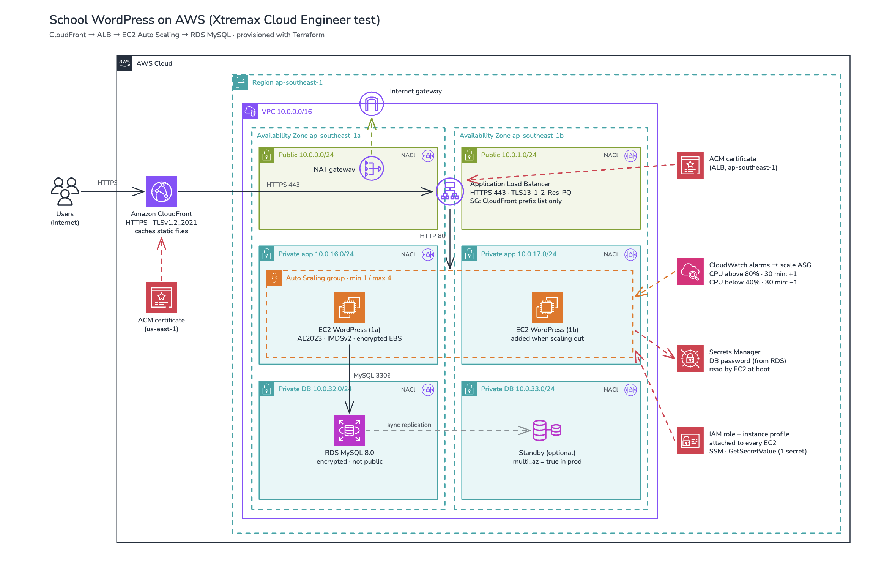
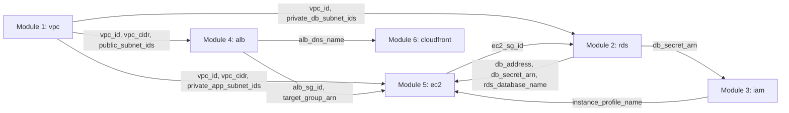

# School WordPress on AWS: Terraform

WordPress for PT Yakin Bisa Lolos on **CloudFront → Application Load Balancer → EC2 Auto Scaling group → RDS MySQL**, provisioned with Terraform in `ap-southeast-1`.

## System diagram



Request path: **Users → CloudFront (HTTPS 443) → ALB (HTTPS 443) → EC2 WordPress in an Auto Scaling group (HTTP 80, inside the VPC) → RDS MySQL (3306)**.

- **Network:** one VPC across 2 Availability Zones, with 3 subnet tiers per AZ: public (ALB, NAT gateway), private app (EC2), private DB (RDS). Every subnet has a network ACL.
- **Scaling:** CloudWatch alarms add an instance when average CPU is above 80% for 30 minutes and remove one when it is below 40% for 30 minutes (min 1, max 4).
- **Secrets:** RDS creates the database password in Secrets Manager; each EC2 instance reads it at boot through its IAM role.

## Module structure

```text
<root>
├── main.tf               # Combining all module folders that build the Web School Project
├── terraform.tfvars      # Input required for all modules
├── outputs.tf            # Final output when the Web School Project is deployed
├── variables.tf          # Declaration of variables used in main.tf at the root
├── .terraform.lock.hcl   # Pinned provider version
├── README.md             # This document
├── systemDiagram.png     # System diagram
├── plan.txt              # terraform plan output (proof)
└── modules/
    ├── vpc/              # Module 1: network (VPC, subnets, gateways, route tables, NACLs)
    ├── rds/              # Module 2: RDS MySQL      imports vpc, ec2
    ├── iam/              # Module 3: EC2 role       imports rds
    ├── alb/              # Module 4: load balancer  imports vpc
    ├── ec2/              # Module 5: WordPress ASG  imports vpc, alb, iam, rds
    └── cloudfront/       # Module 6: CDN            imports alb
```

Modules never call each other directly. Root `main.tf` takes an **output** of one module and passes it as an **input** of another; "imports" below means exactly that.



---

## `main.tf` at the root

**Combining all module folders that build the Web School Project.**

It configures the AWS provider and calls the six modules in build order: `vpc` → `rds` → `iam` → `alb` → `ec2` → `cloudfront`.

| Module | Gets output from another module | Gets value from a root variable |
|---|---|---|
| `vpc` | — | `vpc_cidr`, `azs` |
| `rds` | `vpc_id` ← `module.vpc.vpc_id` · `subnet_ids` ← `module.vpc.private_db_subnet_ids` · `ec2_security_group_id` ← `module.ec2.ec2_sg_id` | `db_name`, `db_username`, `db_instance_class`, `multi_az` |
| `iam` | `db_secret_arn` ← `module.rds.db_secret_arn` | — |
| `alb` | `vpc_id` ← `module.vpc.vpc_id` · `vpc_cidr` ← `module.vpc.vpc_cidr` · `subnet_ids` ← `module.vpc.public_subnet_ids` | `certificate_arn` ← `alb_certificate_arn` |
| `ec2` | `vpc_id`, `vpc_cidr` ← `module.vpc` · `subnet_ids` ← `module.vpc.private_app_subnet_ids` · `sg_alb_id` ← `module.alb.alb_sg_id` · `target_group_arn` ← `module.alb.target_group_arn` · `iam_instance_profile` ← `module.iam.instance_profile_name` · `db_name` ← `module.rds.rds_database_name` · `db_host` ← `module.rds.db_address` · `db_secret_arn` ← `module.rds.db_secret_arn` | `image_id`, `instance_type` |
| `cloudfront` | `alb_dns_name` ← `module.alb.alb_dns_name` | `domain_name`, `certificate_arn` ← `cloudfront_certificate_arn` |

`rds` and `ec2` import from each other (RDS allows MySQL from the EC2 security group; EC2 needs the RDS address). This is not a dependency cycle: Terraform orders it by resource as EC2 security group → RDS → IAM policy → EC2 launch template → Auto Scaling group.

Provider settings:

| Setting | Why |
|---|---|
| `region = var.aws_region` | One place to change the region |
| `default_tags` (`Project`, `ManagedBy`) | Every resource is tagged without repeating tags in each module |
| `skip_credentials_validation`, `skip_requesting_account_id`, `skip_metadata_api_check` | Lets `terraform plan` run with mock credentials and no AWS account; harmless with real credentials |
| `required_version = ">= 1.5"`, AWS provider `~> 5.92` | Pinned versions; `.terraform.lock.hcl` locks the exact provider build |

## `terraform.tfvars`

**Consists of input required for all modules.** Only the required variables need values; everything else uses its default from `variables.tf`.

| Variable | Value in this project | What to put for a real deployment |
|---|---|---|
| `aws_region` | `"ap-southeast-1"` | Region to deploy in |
| `domain_name` | `"school.example.com"` | A domain you own |
| `alb_certificate_arn` | example ARN in `ap-southeast-1` | ACM certificate for `domain_name`, issued in the deployment region |
| `cloudfront_certificate_arn` | example ARN in `us-east-1` | ACM certificate for `domain_name`, issued in **us-east-1** (CloudFront only accepts certificates from there) |
| `image_id` | `"ami-0123456789abcdef0"` | Current Amazon Linux 2023 AMI: `aws ssm get-parameter --name /aws/service/ami-amazon-linux-latest/al2023-ami-kernel-default-x86_64 --query Parameter.Value --output text` |

The file contains **no secrets**: RDS generates the database password into Secrets Manager.

## `outputs.tf` at the root

**Displaying the final output when the Web School Project is deployed.**

| Output | Getting output from | What it shows |
|---|---|---|
| `website_url` | `var.domain_name` | `https://school.example.com`; point the domain at `cloudfront_domain_name` (Route 53 alias or CNAME) |
| `cloudfront_domain_name` | Module 6 `cloudfront` | `xxxx.cloudfront.net` address of the CDN |
| `cloudfront_distribution_id` | Module 6 `cloudfront` | Used to invalidate the CloudFront cache |
| `alb_dns_name` | Module 4 `alb` | ALB address (reachable only from CloudFront) |
| `asg_name` | Module 5 `ec2` | Auto Scaling group name |
| `rds_address` | Module 2 `rds` | Database host name (private, reachable only from EC2) |
| `db_secret_arn` | Module 2 `rds` | Secret holding the DB login: `aws secretsmanager get-secret-value --secret-id <arn>` |
| `vpc_id` | Module 1 `vpc` | ID of the created VPC |

## `variables.tf` at the root

**Declaration of variables used in `main.tf` at the root.**

| Variable | Type | Default | Passed to | Purpose |
|---|---|---|---|---|
| `aws_region` | `string` | `"ap-southeast-1"` | provider | Region for everything except the CloudFront certificate |
| `vpc_cidr` | `string` | `"10.0.0.0/16"` | `vpc` | VPC address range |
| `azs` | `list(string)` | `["ap-southeast-1a", "ap-southeast-1b"]` | `vpc` | Availability Zones (at least 2) |
| `domain_name` | `string` | required | `cloudfront`, `outputs.tf` | Website domain; both certificates must cover it |
| `alb_certificate_arn` | `string` | required | `alb` | ACM certificate in `ap-southeast-1` |
| `cloudfront_certificate_arn` | `string` | required | `cloudfront` | ACM certificate in `us-east-1` |
| `image_id` | `string` | required | `ec2` | Amazon Linux 2023 AMI ID |
| `instance_type` | `string` | `"t3.micro"` | `ec2` | EC2 instance type |
| `db_name` | `string` | `"wordpress"` | `rds` | WordPress database name |
| `db_username` | `string` | `"wpadmin"` | `rds` | RDS master username |
| `db_instance_class` | `string` | `"db.t3.micro"` | `rds` | RDS instance class |
| `multi_az` | `bool` | `false` | `rds` | RDS standby in a second AZ; `true` for production |

---

## Module 1: `vpc` (network)

Creates the VPC, 6 subnets (public, private app and private DB in each of 2 AZs), an internet gateway, one NAT gateway with an Elastic IP, 3 route tables with 6 associations, and 3 network ACLs (22 resources).

| Subnet tier | AZ a | AZ b | Route to the internet | Used by |
|---|---|---|---|---|
| Public | `10.0.0.0/24` | `10.0.1.0/24` | Internet gateway | ALB, NAT gateway |
| Private app | `10.0.16.0/24` | `10.0.17.0/24` | NAT gateway (outbound only) | EC2 |
| Private DB | `10.0.32.0/24` | `10.0.33.0/24` | None | RDS |

**Imports from:** no other module (first module).

| Input | Type | Default | Value comes from | Purpose |
|---|---|---|---|---|
| `vpc_cidr` | `string` | `"10.0.0.0/16"` | root `var.vpc_cidr` | VPC address range; subnet ranges are calculated from it with `cidrsubnet()` |
| `azs` | `list(string)` | 2 AZs | root `var.azs` | Availability Zones; validated to be at least 2 |

| Output | Description | Used by |
|---|---|---|
| `vpc_id` | VPC ID | `rds`, `alb`, `ec2`, root output |
| `vpc_cidr` | VPC CIDR block | `alb` (egress to EC2), `ec2` (egress to MySQL) |
| `public_subnet_ids` | Public subnet IDs | `alb` |
| `private_app_subnet_ids` | Private app subnet IDs | `ec2` |
| `private_db_subnet_ids` | Private DB subnet IDs | `rds` |

## Module 2: `rds` (MySQL database)

Creates the DB subnet group (private DB subnets in 2 AZs), the RDS security group (MySQL in from the EC2 security group only; no outbound rules) and the RDS MySQL 8.0 instance: 20 GB gp3, storage encrypted, not publicly accessible, master password managed in Secrets Manager, 7-day automated backups, `multi_az` optional (3 resources).

**Imports from:** Module 1 `vpc` (network) and Module 5 `ec2` (security group allowed in).

| Input | Type | Default | Value comes from | Purpose |
|---|---|---|---|---|
| `vpc_id` | `string` | required | `module.vpc.vpc_id` | VPC for the security group |
| `subnet_ids` | `list(string)` | required | `module.vpc.private_db_subnet_ids` | Private DB subnets (2 AZs) |
| `ec2_security_group_id` | `string` | required | `module.ec2.ec2_sg_id` | Only this security group may reach MySQL |
| `db_name` | `string` | required | root `var.db_name` | Database created at launch |
| `db_username` | `string` | required | root `var.db_username` | Master username; RDS generates the password into Secrets Manager |
| `db_instance_class` | `string` | `"db.t3.micro"` | root `var.db_instance_class` | Instance class |
| `multi_az` | `bool` | `false` | root `var.multi_az` | Standby copy in a second AZ |
| `db_port` | `number` | `3306` | default | MySQL port (security group and instance) |
| `db_identifier` | `string` | `"mysql-school"` | default | RDS instance identifier |

| Output | Description | Used by |
|---|---|---|
| `db_address` | Host name without port | `ec2` (`db_host`), root output `rds_address` |
| `db_secret_arn` | Secrets Manager ARN with the DB username and password | `iam`, `ec2`, root output |
| `rds_database_name` | Database name | `ec2` (`db_name`) |
| `rds_sg_id` | RDS security group ID | — (reference) |
| `rds_port` | Database port | — (reference) |

## Module 3: `iam` (EC2 identity)

Creates the EC2 role (only `ec2.amazonaws.com` may assume it), attaches `AmazonSSMManagedInstanceCore` (Session Manager instead of SSH), adds an inline policy allowing **only** `secretsmanager:GetSecretValue` on **one** secret, and creates the instance profile (4 resources).

**Imports from:** Module 2 `rds` (the secret to allow).

| Input | Type | Default | Value comes from | Purpose |
|---|---|---|---|---|
| `db_secret_arn` | `string` | required | `module.rds.db_secret_arn` | The only secret the role may read |

| Output | Description | Used by |
|---|---|---|
| `instance_profile_name` | Instance profile name | `ec2` |
| `role_name` | Role name | — (reference) |

## Module 4: `alb` (Application Load Balancer)

Creates the ALB security group (HTTPS 443 in from the CloudFront prefix list only; HTTP 80 out to the VPC only), the internet-facing ALB in both public subnets, the target group (HTTP 80, health check `/` accepting `200-399`) and the HTTPS 443 listener with policy `ELBSecurityPolicy-TLS13-1-2-Res-PQ-2025-09` (4 resources).

**Imports from:** Module 1 `vpc` (network and public subnets).

| Input | Type | Default | Value comes from | Purpose |
|---|---|---|---|---|
| `vpc_id` | `string` | required | `module.vpc.vpc_id` | VPC for the security group and target group |
| `vpc_cidr` | `string` | required | `module.vpc.vpc_cidr` | The ALB may send HTTP 80 only inside this range |
| `subnet_ids` | `list(string)` | required | `module.vpc.public_subnet_ids` | Public subnets; validated to be at least 2 (2 AZs) |
| `certificate_arn` | `string` | required | root `var.alb_certificate_arn` | ACM certificate for the HTTPS listener |
| `cloudfront_prefix_list_id` | `string` | `"pl-31a34658"` | default | AWS managed prefix list `com.amazonaws.global.cloudfront.origin-facing` in `ap-southeast-1` |
| `enable_deletion_protection` | `bool` | `false` | default | Block deleting the ALB; `true` for production |

| Output | Description | Used by |
|---|---|---|
| `alb_sg_id` | ALB security group ID | `ec2` (only the ALB may reach EC2 on port 80) |
| `target_group_arn` | Target group ARN | `ec2` (the Auto Scaling group registers instances here) |
| `alb_dns_name` | ALB DNS name | `cloudfront` (origin), root output |

## Module 5: `ec2` (WordPress Auto Scaling group)

Creates the launch template (Amazon Linux 2023, IMDSv2 required, encrypted gp3 root disk, no public IP, detailed monitoring; `user_data.sh` installs WordPress and reads the DB login from Secrets Manager), the EC2 security group (HTTP 80 in from the ALB only; out: HTTP/HTTPS through the NAT gateway for packages and AWS APIs, MySQL 3306 only inside the VPC), the Auto Scaling group (**min 1 / max 4**, ELB health checks), and two simple scaling policies with their CloudWatch alarms (7 resources):

| Alarm | Condition | Action |
|---|---|---|
| `scale-up-alarm` | Average CPU **> 80%** for **30 minutes** (30 × 60 s) | Add 1 instance |
| `scale-down-alarm` | Average CPU **< 40%** for **30 minutes** (30 × 60 s) | Remove 1 instance |

**Imports from:** Module 1 `vpc`, Module 4 `alb`, Module 3 `iam` and Module 2 `rds`.

| Input | Type | Default | Value comes from | Purpose |
|---|---|---|---|---|
| `vpc_id` | `string` | required | `module.vpc.vpc_id` | VPC for the security group |
| `vpc_cidr` | `string` | required | `module.vpc.vpc_cidr` | EC2 may reach MySQL (3306) only inside this range |
| `subnet_ids` | `list(string)` | required | `module.vpc.private_app_subnet_ids` | Private app subnets for the Auto Scaling group |
| `sg_alb_id` | `string` | required | `module.alb.alb_sg_id` | Only the ALB may reach EC2 on port 80 |
| `target_group_arn` | `string` | required | `module.alb.target_group_arn` | Target group the Auto Scaling group registers instances in |
| `iam_instance_profile` | `string` | required | `module.iam.instance_profile_name` | Instance profile attached to every instance |
| `db_name` | `string` | required | `module.rds.rds_database_name` | Written into `wp-config.php` |
| `db_host` | `string` | required | `module.rds.db_address` | RDS address (without port), written into `wp-config.php` |
| `db_secret_arn` | `string` | required | `module.rds.db_secret_arn` | Secret read at boot for the DB username and password |
| `image_id` | `string` | required | root `var.image_id` | Amazon Linux 2023 AMI; validated to start with `ami-` |
| `instance_type` | `string` | `"t2.micro"` | root `var.instance_type` (`t3.micro`) | EC2 instance type |

| Output | Description | Used by |
|---|---|---|
| `ec2_sg_id` | EC2 security group ID | `rds` (only EC2 may reach MySQL) |
| `asg_name` | Auto Scaling group name | root output `asg_name` |
| `asg_arn` | Auto Scaling group ARN | — (reference) |

## Module 6: `cloudfront` (CDN)

Creates the CloudFront distribution (1 resource): origin is the ALB over **HTTPS only** (TLS 1.2); visitors are redirected from HTTP to HTTPS with minimum `TLSv1.2_2021`; pages, login and admin are **not cached** (`Managed-CachingDisabled`); `/wp-content/*` (uploads, themes, plugins) is **cached at the edge** (`Managed-CachingOptimized`); `Managed-AllViewer` forwards the visitor's Host header so WordPress builds correct links and CloudFront checks the ALB certificate against `domain_name`.

**Imports from:** Module 4 `alb` (the origin).

| Input | Type | Default | Value comes from | Purpose |
|---|---|---|---|---|
| `alb_dns_name` | `string` | required | `module.alb.alb_dns_name` | ALB DNS name (origin) |
| `domain_name` | `string` | required | root `var.domain_name` | Website domain (CloudFront alias); the ALB certificate must cover it too |
| `certificate_arn` | `string` | required | root `var.cloudfront_certificate_arn` | ACM certificate for `domain_name`; validated to be in `us-east-1` |

| Output | Description | Used by |
|---|---|---|
| `distribution_id` | Distribution ID (cache invalidation) | root output `cloudfront_distribution_id` |
| `cloudfront_domain_name` | `xxxx.cloudfront.net` | root output `cloudfront_domain_name` |
| `cloudfront_zone_id` | Hosted zone ID for a Route 53 alias record | — (reference) |

---

## Security measures

### 1. HTTPS: encryption in transit

| Hop | Protocol | Setting |
|---|---|---|
| Visitor → CloudFront | HTTPS | `viewer_protocol_policy = "redirect-to-https"` (HTTP is redirected), `minimum_protocol_version = "TLSv1.2_2021"`, ACM certificate in us-east-1 |
| CloudFront → ALB | HTTPS | `origin_protocol_policy = "https-only"`, `origin_ssl_protocols = ["TLSv1.2"]` |
| ALB listener | HTTPS 443 | `ELBSecurityPolicy-TLS13-1-2-Res-PQ-2025-09`: TLS 1.2 and 1.3 only, restricted ciphers, post-quantum key exchange; ACM certificate in ap-southeast-1 |
| ALB → EC2 | HTTP 80 | Stays inside the private VPC network; TLS ends at the ALB. `wp-config.php` trusts `X-Forwarded-Proto` so WordPress builds `https://` links |

### 2. Security groups: stateful, per resource

Each security group only accepts traffic from the layer in front of it.

| Security group | Inbound | Outbound |
|---|---|---|
| ALB | 443 from the CloudFront origin-facing prefix list (`pl-31a34658`) only | 80 to the VPC CIDR only |
| EC2 | 80 from the **ALB security group** only | 80/443 to the internet through the NAT gateway (packages, wordpress.org, AWS APIs); 3306 to the VPC CIDR only |
| RDS | 3306 from the **EC2 security group** only | **None** |

No security group allows SSH (port 22). Administrators use AWS Systems Manager Session Manager.

### 3. Network ACLs: stateless, per subnet tier

Second layer behind the security groups. NACLs are stateless, so each tier also allows ephemeral ports 1024–65535 for return traffic. Tier blocks: public `10.0.0.0/20`, app `10.0.16.0/20`, DB `10.0.32.0/20`.

| NACL | Inbound allow | Outbound allow |
|---|---|---|
| Public (ALB, NAT) | 443 from anywhere (CloudFront; the ALB security group narrows it) · 80 from the app tier (to the NAT) · 1024–65535 replies | 80, 443 and 1024–65535 |
| Private app (EC2) | 80 from the public tier only · 1024–65535 replies | 80, 443 (through the NAT) · 3306 to the DB tier only · 1024–65535 replies to the public tier |
| Private DB (RDS) | **3306 from the app tier only** | 1024–65535 replies to the app tier only |

Everything else is denied by the NACL's default deny rule.

### 4. Network isolation

- EC2 and RDS have **no public IP addresses** (`associate_public_ip_address = false`, `publicly_accessible = false`).
- Private app subnets reach the internet only **outbound**, through the NAT gateway.
- Private DB subnets have **no route to the internet** at all.
- The ALB accepts traffic only from CloudFront, so visitors cannot bypass the CDN.

### 5. IAM: least privilege

| Permission | Scope |
|---|---|
| Who can use the role | Only `ec2.amazonaws.com` (trust policy) |
| `AmazonSSMManagedInstanceCore` | Session Manager access instead of SSH keys |
| `secretsmanager:GetSecretValue` | **Only** on the one RDS master secret (no wildcard) |

No other permissions are granted. There are no access keys on the instances: they use temporary credentials from the instance profile.

### 6. Secrets

- `manage_master_user_password = true`: RDS generates the master password and stores it in Secrets Manager. It is **not** in the code, `terraform.tfvars` or user data.
- At boot, the instance reads the secret through its IAM role and saves it to `/etc/wordpress/db.json` (owner `root:apache`, mode `640`). `wp-config.php` reads it from there.

### 7. Encryption at rest and hardening

| Measure | Where |
|---|---|
| EBS root volume encrypted | EC2 launch template |
| RDS storage encrypted | `storage_encrypted = true` |
| Secrets encrypted with AWS KMS | Secrets Manager |
| IMDSv2 required | `http_tokens = "required"` blocks token-less metadata requests (SSRF credential theft) |
| Invalid HTTP headers dropped | `drop_invalid_header_fields = true` on the ALB |
| Dynamic pages not cached | CloudFront default behavior uses `CachingDisabled`, so logged-in pages are never served to other users |
| Automated backups | RDS keeps 7 days (point-in-time restore); `multi_az` available for production |

---

## Test plan and results

No AWS resources were created (see Assumptions). Testing has four offline layers plus a plan for after deployment.

### Summary

| # | Layer | Tool | Result |
|---|---|---|---|
| 1 | Formatting and syntax | `terraform fmt -check -recursive`, `terraform validate` | ✅ Pass |
| 2 | Plan | `terraform plan` with mock credentials → `plan.txt` | ✅ `Plan: 41 to add, 0 to change, 0 to destroy` |
| 3 | Requirement check | Each PDF requirement checked against the values in `plan.txt` (below) | ✅ All met |
| 4 | Security scan | Trivy `config` (Docker) | ✅ 80 checks passed · 9 findings, each fixed-by-design or accepted (below) |
| 5 | WordPress boot script | `user_data.sh` run in Amazon Linux 2023 + MySQL 8.0 containers | ✅ All checks passed |

### Requirement check (evidence in `plan.txt`)

| PDF requirement | Value in `plan.txt` | Result |
|---|---|---|
| CloudFront as CDN | `origin` = ALB DNS name · `ordered_cache_behavior` `path_pattern = "/wp-content/*"` (cached) | ✅ |
| ALB for high availability | ALB `subnets` = 2 public subnets in `ap-southeast-1a` and `ap-southeast-1b` · target group `matcher = "200-399"` | ✅ |
| EC2 running WordPress in an Auto Scaling group | Launch template `user_data` (installs WordPress) · `aws_autoscaling_group` with `target_group_arns` | ✅ |
| Min 1 / max 4 servers | `min_size = 1`, `max_size = 4` | ✅ |
| Scale up when CPU > 80% for 30 min | `comparison_operator = "GreaterThanThreshold"`, `threshold = 80`, `period = 60` × `evaluation_periods = 30` → `scaling_adjustment = 1` | ✅ |
| Scale down when CPU < 40% for 30 min | `comparison_operator = "LessThanThreshold"`, `threshold = 40`, `period = 60` × `evaluation_periods = 30` → `scaling_adjustment = -1` | ✅ |
| RDS MySQL stores the data securely | `engine = "mysql"`, `storage_encrypted = true`, `publicly_accessible = false`, `manage_master_user_password = true`, `backup_retention_period = 7` | ✅ |
| HTTPS on CloudFront | `viewer_protocol_policy = "redirect-to-https"`, `minimum_protocol_version = "TLSv1.2_2021"`, `origin_protocol_policy = "https-only"` | ✅ |
| HTTPS on ALB | Listener `protocol = "HTTPS"`, `port = 443`, `ssl_policy = "ELBSecurityPolicy-TLS13-1-2-Res-PQ-2025-09"` | ✅ |
| Security groups restrict EC2 and RDS | ALB in from `pl-31a34658` only · EC2 in 80 from the ALB security group only · RDS in 3306 from the EC2 security group only, no egress | ✅ |
| Network ACLs restrict EC2 and RDS | 3 `aws_network_acl` resources (public, private app, private DB) with the rules in the Security section | ✅ |
| IAM least privilege | Role trusted by `ec2.amazonaws.com` only · `AmazonSSMManagedInstanceCore` · inline policy `secretsmanager:GetSecretValue` on the DB secret only (shown as "known after apply" in the plan because the secret ARN is created by RDS; see `modules/iam/main.tf`) | ✅ |
| Instance hardening | `http_tokens = "required"` (IMDSv2) · `associate_public_ip_address = "false"` · EBS `encrypted = "true"` · ALB `drop_invalid_header_fields = true` | ✅ |

### Security scan (Trivy)

80 checks passed. Findings and decisions:

| Severity | Finding | Decision |
|---|---|---|
| Critical ×2 | EC2 security group allows 80/443 out to `0.0.0.0/0` | **Accepted.** Needed for `dnf`, wordpress.org and the Secrets Manager / SSM APIs; traffic leaves only through the NAT gateway and nothing can come in. Production: pre-built AMI with WordPress plus VPC endpoints for AWS APIs |
| High | No WAF on CloudFront | **Accepted for this scope.** Recommended addition: AWS WAF with the AWS managed WordPress and common rule sets |
| High | ALB is internet-facing | **By design.** CloudFront must reach it; the ALB security group allows only CloudFront's prefix list |
| Medium | RDS deletion protection disabled | **Test setting** so the stack can be destroyed; enable in production |
| Medium | No VPC Flow Logs | **Accepted.** Recommended for production (CloudWatch Logs) |
| Medium | No CloudFront access logs | **Accepted.** Recommended for production (S3 bucket) |
| Medium | RDS IAM database authentication disabled | **Accepted.** WordPress connects with a username and password, kept in Secrets Manager |
| Low | RDS Performance Insights disabled | **Accepted.** Optional monitoring |
| *(fixed)* | RDS backups kept only 1 day | **Fixed:** `backup_retention_period = 7` |

### WordPress boot script

`user_data.sh`, rendered exactly as Terraform renders it, was run in an `amazonlinux:2023` container next to a `mysql:8.0` container. A stub `aws` command returned the secret JSON; the password contained special characters (`& | \ $ % ! #`).

| Check | Result |
|---|---|
| Script completes under `set -euo pipefail` | ✅ exit 0 |
| `GET /` (what the ALB health check sees) | ✅ `302 → /wp-admin/install.php` (why the target group accepts `200-399`) |
| Request behind the ALB (`X-Forwarded-Proto: https`) | ✅ redirects to `https://school.example.com/...` |
| WordPress connects to MySQL | ✅ installer page, no "Error establishing a database connection" |
| Installer writes to the database | ✅ 12 tables created; site title served |
| Secret file permissions | ✅ `/etc/wordpress/db.json` is `-rw-r----- root:apache` |
| Password not stored in `wp-config.php` or user data | ✅ |
| AWS calls made | ✅ exactly one: `secretsmanager get-secret-value` for the DB secret |

This test found one bug, now fixed: `tar` was not installed by the script (added to `dnf install`).

### After deployment (not executed: no deployable account)

| # | Test | Expected result |
|---|---|---|
| 1 | `curl -I https://<domain>` | `200` or `302` from WordPress through CloudFront |
| 2 | `curl -I http://<domain>` | `301` redirect to HTTPS |
| 3 | `curl -I https://<alb_dns_name>` from the internet | Connection times out (ALB accepts only CloudFront) |
| 4 | `aws ec2 describe-instances` for the ASG instances | No public IP addresses |
| 5 | Connect to `<rds_address>:3306` from outside the VPC | Fails (no public access, no route) |
| 6 | Session Manager → instance → `nc -zv <rds_address> 3306` | Succeeds |
| 7 | Session Manager → `aws secretsmanager get-secret-value` for any **other** secret | `AccessDeniedException` |
| 8 | Load CPU above 80% for 30 min (e.g. `stress-ng`) | Scale-up alarm fires; ASG goes 1 → 2 |
| 9 | Stop the load; CPU below 40% for 30 min | Scale-down alarm fires; ASG returns to 1 |
| 10 | Terminate an instance | ASG launches a replacement; target becomes healthy |
| 11 | Repeat request for `/wp-content/...` | `X-Cache: Hit from cloudfront` |

### How to run the checks

```bash
terraform init
terraform fmt -check -recursive
terraform validate

AWS_ACCESS_KEY_ID=mock AWS_SECRET_ACCESS_KEY=mock terraform plan -out=tfplan
terraform show -no-color tfplan > plan.txt
```

---

## Assumptions and limitations

| Item | Detail |
|---|---|
| Plan only, no real deployment | The PDF accepts `terraform plan` as proof. The available AWS account's organization policy explicitly denies EC2, ELB, RDS, Auto Scaling, CloudWatch alarms and Secrets Manager, so `plan.txt` was generated with **mock credentials** |
| Domain and certificates | `school.example.com` and both ACM certificate ARNs are example values. A real deployment needs a domain you own, a certificate in ap-southeast-1 (ALB) and one in us-east-1 (CloudFront), and a DNS record pointing the domain at CloudFront |
| AMI | `image_id` is an example value; use the current Amazon Linux 2023 AMI (command in `terraform.tfvars`) |
| Uploads with more than one instance | `wp-content/uploads` is stored on each instance's own disk, so media uploaded on one instance is not on the others. Production: Amazon EFS for `wp-content`, or offload media to S3 |
| One NAT gateway | Saves cost. If its AZ fails, instances in the other AZ lose outbound internet (existing traffic through the ALB keeps working). Production: one NAT gateway per AZ |
| WordPress installed at boot | Each new instance downloads packages and WordPress (needs the NAT gateway; about 1–2 minutes). Production: a pre-built AMI |
| Single region | No cross-region disaster recovery |
| Test-friendly settings | `skip_final_snapshot = true`, deletion protection off, `multi_az = false`; switch for production |
| Optional extras not included | AWS WAF, VPC Flow Logs, CloudFront access logs, a secret header between CloudFront and the ALB |
